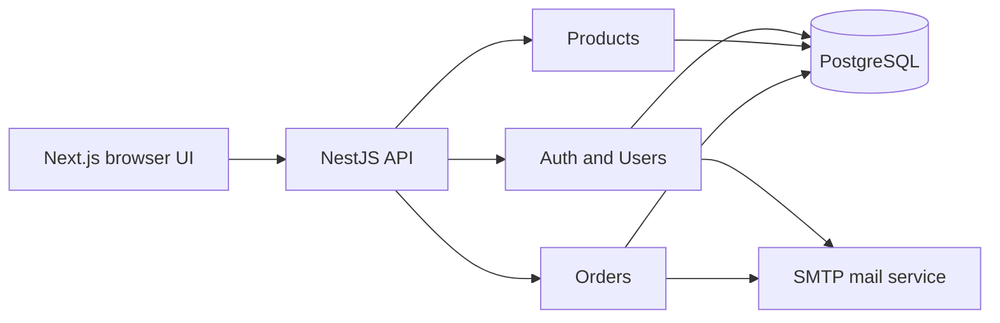
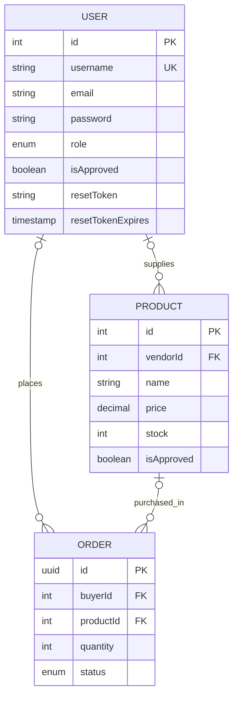

# B2B Marketplace

A buyer, vendor, and administrator marketplace built with a Next.js frontend and a NestJS API. Buyers browse approved products and place orders. Vendors register for approval, create products, and manage fulfillment. Administrators approve vendor accounts and product listings.

This repository is a portfolio case study, not a deployed service. See [the architecture case study](docs/CASE_STUDY.md) and [the remediation report](docs/REMEDIATION_REPORT.md) for the security decisions, test evidence, and limits.

## Stack and architecture

| Layer | Implementation |
| --- | --- |
| Frontend | Next.js 16 App Router, React 19, TypeScript, Tailwind CSS, Axios |
| API | NestJS 11, TypeScript, Passport JWT, class-validator |
| Data | PostgreSQL, TypeORM 0.3, explicit migrations |
| Email | Nest mailer, Nodemailer, Handlebars templates |



The API modules are `AuthModule` (registration, login, JWT, reset), `UsersModule` (profiles and administration), `ProductsModule` (catalog and moderation), `OrdersModule` (purchasing and fulfillment), and `MailModule` (reset and order mail). The frontend calls the API at `http://localhost:3000`.

## Roles and workflows

| Role | Main flow |
| --- | --- |
| Buyer | Register, log in, browse approved in-stock products, order, view or cancel pending orders, update profile. |
| Vendor | Register for approval, log in after approval, create products, view own products and orders, update order status. |
| Administrator | Log in, list accounts, approve or reject vendors, approve or reject products, create managed accounts through the guarded root `POST /` route. |

Public registration accepts only `buyer` and `vendor`. It cannot assign `admin`. The managed account creation route requires a current ADMIN account. An initial administrator must be provisioned through an operator-controlled database process; this repository does not expose a public bootstrap route. JWT validation reads the current role and vendor approval state from the database on each guarded request. A vendor whose approval is revoked cannot continue using an old JWT.

The frontend currently stores its JWT in browser local storage. A future production deployment should review that session model and add appropriate browser security controls.

## Data model



The migrations add unique indexes on `lower(email)` and non-null reset-code hashes. Credential fields in the entity are storage fields; user and order API services return explicit safe projections instead of serializing those fields. Order creation reserves stock and inserts the order in one transaction.

## Password reset

`POST /auth/forgot-password` accepts an email and returns the same neutral message whether the account exists, mail delivery fails, or mail delivery succeeds. For an existing account, the server emails a six digit code, stores only its HMAC-SHA-256 hash, and sets a 15 minute expiry. `POST /auth/reset-password` atomically updates the password and clears a matching, unexpired code. Codes cannot be reused. Mail failures are logged without email addresses or codes, and the code is cleared when delivery fails. Login and reset routes use in-memory per-IP request limits. The limits are not shared across multiple API instances.

## Local setup

Prerequisites: Node.js 20.9 or newer, npm, and PostgreSQL with permission to create tables and indexes. Tests create and remove their own temporary PostgreSQL databases, so the test role also needs `CREATEDB`.

1. In `nestJS_backend`, run `npm ci`.
2. Create `nestJS_backend/.env` with the following keys. Never commit the file:

   ```env
   DATABASE_URL=<PostgreSQL connection URL>
   JWT_SECRET=<long random secret>
   MAIL_HOST=<SMTP host>
   MAIL_PORT=<SMTP port>
   MAIL_USER=<SMTP username>
   MAIL_PASS=<SMTP password>
   MAIL_FROM=<sender address>
   PORT=3000
   ```

3. Review the target schema and existing email or reset-code duplicates before migration. Run `npm run migration:show`, then deliberately run `npm run migration:run` in `nestJS_backend`. The application never runs migrations or schema synchronization at startup. The baseline migration creates tables only when absent; the second adds the case-insensitive email index and the third makes non-null reset-code hashes unique. A pre-existing schema with unexpected columns or duplicates needs manual review before migration.
4. Start the API with `npm run start:dev` from `nestJS_backend`.
5. In `b2b-frontend`, run `npm ci` and `npm run dev`. The frontend normally uses port 3001 when the API occupies 3000.

To create the first ADMIN, use a controlled database operation with a bcrypt password hash after migrations. Public registration and the frontend cannot bootstrap an ADMIN. Subsequent managed accounts can be created by an authenticated ADMIN through `POST /`. Do not place bootstrap credentials in source, logs, or shell history.

## Verification

From `nestJS_backend`:

```bash
npm run build
npx tsc --noEmit
npm test -- --runInBand
npm run test:e2e -- --runInBand
npm run migration:show
```

The unit suite includes serialized HTTP authorization tests and isolated PostgreSQL migration, uniqueness, reset, and stock concurrency tests. The e2e suite runs registration, login, profile, and reset against a temporary database with a mocked mail transport. It does not send real email or alter the configured application database.

From `b2b-frontend`:

```bash
npx tsc --noEmit
npm run build
```

The backend ESLint check currently reports existing formatting and unsafe-type findings across the repository. See the remediation report for the exact command and result; a green lint result is not claimed.

## Known limits

- Rate limits are stored in one Node process and do not coordinate across replicas or survive restart.
- Reset responses are content-neutral, but SMTP timing may still reveal whether an account exists.
- JWTs are valid for one day; there is no refresh-token or general token revocation flow.
- SMTP delivery was tested with mocks, not a live provider.
- The initial ADMIN needs controlled operator provisioning.
- Order cancellation restores stock and removes the order in separate operations; that path is not yet transactional.
- The frontend uses placeholder product imagery and a hard-coded local API origin.
- This work was verified locally and was not deployed or load tested.
