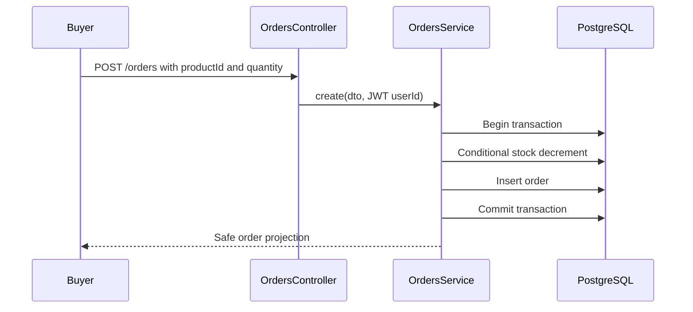

# Marketplace backend case study

## Scope and architecture

The marketplace API is a NestJS application with separate auth, user, product, order, and mail modules. TypeORM maps three PostgreSQL entities: `User`, `Product`, and `Order`. A user may supply products as a vendor and place orders as a buyer. Orders reference a buyer and a product. The database relations are nullable in the original schema, while the application binds these relations when creating products and orders.

Controllers receive DTOs and apply JWT and role guards. Services enforce identity, create database records, and project entities into response shapes. The Next.js frontend consumes these HTTP responses. Keeping those responsibilities in the existing modules avoided a broad rewrite of marketplace behavior.

The conditional decrement requires approved product stock to be at least the requested quantity. If the decrement or order insert fails, the transaction rolls back. Mail is sent only after the order is saved; mail failure is logged without reversing the purchase.

## Role-based access

The `Role` enum has `buyer`, `vendor`, and `admin`. Public `RegisterDto` permits only buyer or vendor. `CreateUserDto` retains the full enum for the guarded administrative `POST /` route. The route requires both JWT authentication and the ADMIN role. This separates public registration from managed account creation without changing buyer and vendor signup payloads.

`JwtStrategy` reads the current account by ID for each guarded request. The role in the signed token is not used as the final authorization source. A revoked vendor approval or changed role takes effect on the next guarded request. Pending vendors also cannot log in. An initial administrator still needs controlled operator provisioning; the repository has no unauthenticated bootstrap route.

Profile updates use an explicit `UpdateUserDto` containing only username, email, company name, and password. `UsersService.update` constructs its own allowlisted update object. A caller cannot set `role`, `isApproved`, reset fields, or identity columns through `PATCH /auth/me`, even if an internal caller passes extra properties. The global `ValidationPipe` rejects unknown JSON properties at the HTTP boundary.

## Response boundaries

TypeORM entities include password hashes and reset-token storage fields. `UsersService` returns `UserResponseDto` projections for registration, profile reads and updates, approvals, and administrative listings. `OrdersService` returns order projections; a vendor sees only buyer ID and username, and product response fields do not include the vendor entity. Public product queries select only the vendor fields shown in the catalog. Tests assert the serialized HTTP bodies, not only service return values.

## Password reset

The existing six digit email-code UI was retained. A cryptographically random code is sent by email; the database stores an HMAC-SHA-256 digest keyed with `JWT_SECRET`, plus an expiry timestamp. A keyed hash is used because a six digit code has low entropy and an ordinary unsalted hash could be enumerated offline. A unique index prevents the same digest from being assigned to two users; generation retries on a collision. The API accepts only a six digit code and a password of at least eight characters. A conditional PostgreSQL update matches the digest and an expiry later than the current time, changes the bcrypt password hash, and clears both reset fields in one statement. Reused or expired codes fail.

Reset requests return the same neutral text for known and unknown addresses. Delivery failures are logged with a generic message; the stored digest is cleared, and the response remains neutral. SMTP timing can still differ for known and unknown addresses. Login and reset endpoints use per-IP fixed-window limits. The limiter is process local, so a multi-instance deployment needs shared storage and a trusted proxy configuration review. A longer, high-entropy reset link would be preferable for a high-scale deployment but would change the current frontend flow.

## Database and migrations

Schema synchronization is disabled in `AppModule`. Three explicit migrations provide a baseline for fresh PostgreSQL databases, a unique index on `lower(email)`, and a partial unique index on stored reset-code hashes. The existing database schema was inspected before migration design: it had the expected tables and enums, six user records, no case-insensitive duplicate email groups, no stored reset codes, and no migration history table. No migration was applied to that configured application database during this work. Operators must review the target and run `npm run migration:run` deliberately. The baseline's down migration refuses to remove tables, protecting existing marketplace data from an accidental rollback.

`UsersService` normalizes new and updated email addresses to lowercase and converts PostgreSQL unique-violation code `23505` into a safe HTTP conflict. The database index closes the race left by a service-only existence check. Tests create and remove a separate temporary PostgreSQL database, run all three migrations, assert duplicate rejection, and start concurrent registrations. They also test reset-code uniqueness, one-time consumption, and stock concurrency against PostgreSQL.

## Verification and trade-offs

HTTP authorization tests cover admin registration rejection, buyer and vendor registration, anonymous and non-admin account creation, profile allowlisting, response serialization, and rate limiting. The e2e suite runs the real Nest app with a temporary database and a mocked mail transport. The backend build, TypeScript compilation, unit suite, e2e suite, frontend TypeScript check, and frontend build passed in the final workstream checks. See [the remediation report](REMEDIATION_REPORT.md) for exact commands and results.

This is a portfolio implementation with explicit limits: no live SMTP verification, process-local rate limiting, browser local-storage JWTs, no refresh or general revocation flow, no automated initial-admin bootstrap, and a nontransactional order-cancellation path. The backend lint check still reports existing formatting and unsafe-type findings. These limits should be resolved or reassessed before claiming production readiness.
